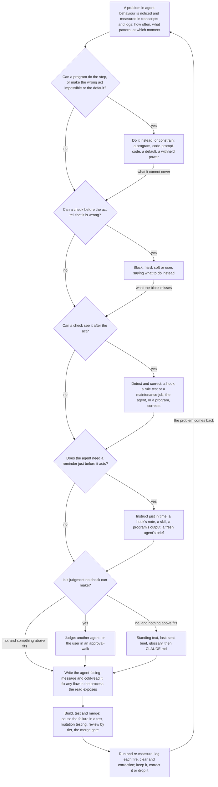

# Inventory of the techniques that instruct and control agents

A working draft, not for merging. It merges two independent reviews of main, one by Codex and one by a Claude subagent, both made from the same brief on 2026-10-21 at commit 5477dc2e. Every path in the table was checked on origin/main at commit 2e02a292, which is later than the reviews: two programs were renamed with the `-nbd` suffix in between. This inventory feeds the key-concepts outline beside it on the topic branch, `docs/drafts/agent-control-techniques-key-concepts-outline-draft.md`, and through it the techniques page.

Kinds follow the outline's section 4, plus two: **constrain** makes the wrong act impossible or the right act the default, and **practice** is a supporting practice used when building or checking a technique. Moments follow the outline's section 3, plus **at commit or push**, for git hooks, which run whichever agent-binary commits. **Page** says whether the techniques page draft covers the technique: yes, partly or no.

## 1. The techniques

| # | Technique | Kind | Moment | Status | Files | Found by | Page |
|---|---|---|---|---|---|---|---|
| 1 | Withheld powers: main needs a review and allows no bypass; one GitHub identity per role, each without powers its role does not need | constrain | outside the session (pull request) | built, by the identities page; the protection is not readable with this seat's token | `docs/nedschorus-wiki/nedschorus-github-identities-and-token-policy.md` | both | no |
| 2 | Restricted fresh-agents: reviewers and helpers run without project hooks or Bash, credentials denied, Codex's memory off | constrain | before the work (a fresh-agent starts) | built | `nc-systems/cold-read/cold-read-cell-common.py`, `nc-systems/cold-read/cold-read-claude-cell.py`, `nc-systems/cold-read/cold-read-codex-cell.py`, `scripts/code-review-codex-cell.py`, `scripts/run-codex-task-from-brief.py` | both | no |
| 3 | `.gitignore` defaults: markers, seat-briefs, review records and walk files stay out of commits | constrain | at commit or push | built | `.gitignore` | both | no |
| 4 | Settings defaults: plugins and skills switched off, no autoupdate, the merge command allowed | constrain | before the work | built | `.claude/settings.json` | Codex | no |
| 5 | Test isolation: a sandbox, credentials and environment removed, signals isolated, locks and timeouts | constrain | at commit or push; outside the session (pull request) | built | `scripts/run-all-test-suites.py`, `scripts/run-suite-in-signal-sandbox.py` | Codex | no |
| 6 | One narrow privilege: a read-only backup mount for recovery | constrain | outside the session | built configuration; installation not checked | `config/sudoers-mount-apfs-readonly-for-backup-recovery`, `scripts/find-deleted-path-across-backups.py` | Codex | no |
| 7 | Launcher environment: each agent-seat's git identity and task list; Claude Code's start-up screens answered in advance | constrain | before the work | built | `scripts/launch-claude-mac`, `scripts/launch-claude-ubuntu`, `scripts/claude-json-agent-seat-folder-trust-and-onboarding-presets-write.py` | both | no |
| 8 | Cold read as code-prompt-code: a frozen copy, six cold-read-cells or one, a ceiling of three full runs, missing reports handled | do it instead | when the agent runs it | built | `nc-systems/cold-read/cold-read-grid.py`, `nc-systems/cold-read/cold-read-fast-read.py`, `.claude/skills/cold-read/SKILL.md` | both | yes |
| 9 | ghi-info, the issue-knowledge agent, as code-prompt-code | do it instead | when the agent runs it | built | `scripts/ghi-info-ask.py`, `scripts/ghi-mirror-refresh.py` | both | yes |
| 10 | GHI write tool: files from the GHI-MD by pull request; soft-blocks a duplicate through `.ghi-issue-write-reconsidered`; records ruling conflicts | do it instead, block | when the agent runs it | built | `scripts/ghi-issue-write.py`, `.claude/skills/ghi-write/SKILL.md` | both | no |
| 11 | Codex task runner: prompt from a file, stdin closed, a deadline, credentials denied | do it instead | when the agent runs it | built | `scripts/run-codex-task-from-brief.py` | both | yes |
| 12 | Locators: a file's copies on both machines and in backups; an approval by its subject | do it instead | when the agent runs it | built | `scripts/locate-file-copies-across-machines.py`, `scripts/locate-user-approval-by-question-subject.py`, `.claude/skills/locate-before-saying-a-file-is-missing/SKILL.md` | both | no |
| 13 | An /explain reply gets a cold-read-fast-read before it is sent | do it instead, judge | when the agent runs it | built | `.claude/skills/explain/SKILL.md`, `nc-systems/skills/explain/explain-reply-cold-read-fast-read.py` | both | no |
| 14 | Handoff-system: the agent writes only the next step; programs write the session-handoff, extract the conversation-tail and start the successor | do it instead | after the act (turn end) | built | `.claude/skills/handoff/SKILL.md`, `nc-systems/handoff/handoff-write-and-check-supervisor.py`, `nc-systems/handoff/handoff-supervisor.py`, `scripts/handoff-extract-conversation.py` | both | no |
| 15 | Crash recovery: the agent-crash-watcher, recovery, restart at login, resupervision | do it instead | outside the session (scheduled) | built | `nc-systems/handoff/handoff-agent-seat-died-without-session-handoff-restart-watcher.py`, `scripts/recover-crashed-seats.py`, `scripts/restart-live-seats-at-login.py`, `scripts/resupervise-seat.py` | both | no |
| 16 | The session trailer, stamped on every commit | do it instead | at commit or push | built | `scripts/git-client-side-hooks/prepare-commit-msg` | both | yes |
| 17 | Work-snapshots: uncommitted changes saved after every edit and shell command | do it instead | after the act | built | `scripts/uncommitted-work-snapshot-hook.py`, `nc-systems/handoff/uncommitted-work-snapshots.py` | both | no |
| 18 | Checkout freshness: rebases a never-pushed branch, fast-forwards safe checkouts, reports a rewritten head, hands the agent CLAUDE.md's changed lines | do it instead, instruct | after the act (turn end); delivered when the prompt arrives | built | `scripts/checkout-freshness-catch-up.py` | both | no |
| 19 | Merge-lane programs: worktrees, a reviewer brief with checked facts and main's instructions, the Codex review, tests at the head, merge through the gate, stacked pull requests retargeted | do it instead | outside the session (pull request) | built | `scripts/merge-lane-pull-request-worktrees-reviewer-brief-codex-review-and-head-tests-run-without-merge.py`, `scripts/merge-lane-pull-request-merge-through-merge-gate-with-stacked-pull-request-retarget.py`, `scripts/merge-lane-pull-request-head-and-merged-worktrees-rebuild.py`, `scripts/merge-lane-pull-request-reviewer-brief-compose-with-facts.py`, `scripts/compose-pull-request-reviewer-brief.py` | both | no |
| 20 | Review tier by content: no reviewer for prose, Codex for tests and docstrings, Claude and Codex for behaviour, hooks and settings | do it instead | outside the session (pull request) | built | `scripts/pull-request-review-plan.py` | both | no |
| 21 | Fix-round brief built from the blocking findings, and a check that one commit answers each | do it instead, detect | outside the session (pull request) | built | `scripts/pull-request-fix-round-author-brief-from-blocking-findings-and-one-commit-every-finding-answered-check.py` | both | no |
| 22 | Tests at a pull request's head, pinned to that commit | detect | outside the session (pull request) | built | `scripts/pull-request-head-test-run.py`, `scripts/merge-lane-pull-request-head-test-run-on-merged-worktree.py` | both | no |
| 23 | Pull request watcher: an event for each opened pull request and new head | detect | outside the session (scheduled) | built | `scripts/watch-open-pull-requests-nbd.py` | both | no |
| 24 | Log-store shipping, add-only: transcripts, dialogs, walk files, cold-read and sanity-check records | do it instead | outside the session (scheduled), or when the agent runs it | built | `scripts/transcript-mirror-to-log-store.py`, `scripts/log-store-session-dialogs-refresh-nbd.py`, `scripts/walk-files-ship.py`, `nc-systems/cold-read/cold-read-record-ship.py`, `scripts/sanity-check-record-ship.py` | both | no |
| 25 | Maintenance-jobs: one table and one installer for each machine's scheduled jobs | do it instead | outside the session (scheduled) | built | `nc-systems/general-tools/scheduled-jobs-on-each-machine.json`, `nc-systems/general-tools/install-scheduled-jobs-on-this-machine.py` | both | partly |
| 26 | Daily full test run of main, on each machine | detect | outside the session (scheduled) | built | `scripts/daily-full-test-run-of-main.py` | both | no |
| 27 | Safe worktree cleanup | do it instead | outside the session (scheduled) | built | `scripts/clean-worktrees.py` | both | no |
| 28 | Design-to-main state machine | do it instead | outside the session | partly built, not running | `scripts/design-to-main/design-to-main-state-machine.py`, `scripts/design-to-main/design-to-main-run-state.py`, `docs/design-to-main/design-to-main-state-machine-design.md` | both | no |
| 29 | main-gatekeeper | block | outside the session | partly built, dormant | `nc-systems/main-gatekeeper/main-gatekeeper.py`, `nc-systems/main-gatekeeper/main-gatekeeper-design.md` | both | no |
| 30 | Instruction-file guard: a user-block cleared by `.walk-approved` with the user's words, a soft-block cleared by `#pre_approved_change` with a reason, or an obvious-fix marker; one use per marker | block | before the act | built | `.claude/hooks/instruction-file-guard.py`, `.claude/hooks/guard_approval_marker.py` | both | yes |
| 31 | Memory-write refusal | block | before the act | built | `.claude/hooks/instruction-file-guard.py` | both | no |
| 32 | Location guard: no writes from a detached HEAD, an unborn repository or the reference-checkout; a user-block through `.location-write-approved` | block | before the act | built | `.claude/hooks/session-location-write-guard.py` | both | no |
| 33 | Backup state guard | block | before the act | built | `.claude/hooks/backup-and-snapshot-write-guard.py` | both | no |
| 34 | Hand-typed `codex exec` refusal | block | before the act | built | `scripts/hand-typed-codex-exec-redirect-hook.py` | both | yes |
| 35 | Hand-typed `gh issue` write refusal | block | before the act | built | `.claude/hooks/ghi-issue-write-redirect.py` | both | no |
| 36 | Force push over an open pull request, cleared by an environment prefix; now an early warning beside row 41 | block | before the act | built | `scripts/force-push-with-open-pull-request-guard-hook.py` | both | no |
| 37 | Synthetic keystrokes, cleared by `CLAUDE_VERIFIED_DETACHED=1` after the agent checks | block | before the act | built | `scripts/synthetic-keystroke-guard-hook.py` | both | no |
| 38 | A glob read as an option; the refusal holds the corrected command | block | before the act | built | `scripts/search-file-argument-read-as-option-guard-hook.py` | both | no |
| 39 | A tmux kill that names no server | block | before the act | built | `nc-systems/general-tools/claude-code-tmux-kill-server-and-kill-session-missing-server-selection-refusal-hook.py` | both | no |
| 40 | Commit identity refusal | block | at commit or push | built | `scripts/git-client-side-hooks/pre-commit`, `scripts/git-client-side-hooks/pre-merge-commit` | both | no |
| 41 | Pre-push: a rewrite or deletion of an open pull request's branch | block | at commit or push | built | `scripts/git-client-side-hooks/pre-push`, `scripts/git-client-side-hooks-pre-push-open-pull-request-branch-non-fast-forward-or-deletion-refusal.py` | both | no |
| 42 | Pre-push: a conflict with main | block | at commit or push | built | `scripts/git-client-side-hooks-pre-push-conflict-check.py`, `scripts/branch-conflict-check.py` | both | no |
| 43 | Pre-push: a push from a mutation-testing worktree | block | at commit or push | built | `scripts/git-client-side-hooks-pre-push-mutation-testing-worktree-push-refusal.py` | both | no |
| 44 | Pre-push: the selective test run | block | at commit or push | built | `scripts/git-client-side-hooks-pre-push-selective-test-run.py` | both | no |
| 45 | Merge gate: the approved commit pinned, unread review activity, a root-cause line, a `#follow_up` link to open work | block | outside the session (pull request) | built | `scripts/merge-gate.sh` | both | partly |
| 46 | Citation reminder on a push that changes Markdown | instruct | before the act | built | `nc-systems/general-tools/claude-code-bash-git-push-of-markdown-change-citation-checks-reminder-hook.py` | both | yes |
| 47 | Obsolete-file edit warning | instruct | after the act | built | `scripts/obsolete-file-edit-warning-hook.py` | both | no |
| 48 | File-name collision warning | instruct | after the act | built | `scripts/file-name-collision-warning-hook.py` | both | no |
| 49 | Style-guide words in Markdown just written | instruct | after the act | built | `scripts/style-guide-word-checker-markdown-edit-hook.py`, `scripts/style-guide-word-checker.py` | both | yes |
| 50 | A Markdown paragraph broken across lines | correct | after the act | built | `scripts/markdown-edit-hard-wrapped-paragraph-reminder-hook-nbd.py` | both | yes |
| 51 | Bare-number citations, in Markdown just written and in the previous reply | correct | after the act; when the prompt arrives | built | `scripts/bare-number-citation-in-markdown-and-agent-reply-warning-hook.py` | both | yes |
| 52 | New shared names, sent to the naming fresh-agent | instruct | after the act | built | `scripts/new-shared-names-reminder-hook.py`, `scripts/new-shared-names-in-changed-files-list.py` | both | partly |
| 53 | Changed agent-facing-messages: the message page, and a cold-read-fast-read command for each | instruct | after the act | built | `nc-systems/general-tools/python-edit-changed-agent-facing-message-check-reminder-hook.py`, `nc-systems/general-tools/python-source-agent-facing-string-collector-common.py` | both | partly |
| 54 | A guarded-file changed without approval: every version kept; the agent asks the user, then runs `--approve` or `--restore` | correct | after the act | built | `.claude/hooks/guarded-file-unapproved-change-afterward-backup-and-ask-hook.py` | both | yes |
| 55 | An absence claim in a reply: the stop is blocked once and the agent sent to the locator; each fire logged | correct | after the act (turn end) | built | `scripts/absence-claim-locator-reminder-hook.py` | both | yes |
| 56 | A linked Markdown document that had no cold read | correct | after the act (turn end) | built | `scripts/cold-read-fast-read-due-for-linked-document-reminder-hook.py` | both | yes |
| 57 | A reply that does not name the waiting approval-walk item | correct | after the act (turn end) | built | `nc-systems/skills/walk-me-through/walk-me-through-current-item-shown-to-user-after-each-agent-message-stop-hook.py` | both | yes, under Blocking |
| 58 | A ned-box path in a reply that the user cannot open on his Mac | correct | when the prompt arrives | built | `scripts/ned-box-path-in-agent-reply-unclickable-on-mac-warning-hook.py` | both | yes |
| 59 | A task that is due, or whose prerequisite is met, raised at turn end | instruct | after the act (turn end) | built | `scripts/agent-seat-due-task-raise-hook.py`, `scripts/seat-task-list-read.py` | both | yes |
| 60 | Handoff threshold: the stop is blocked and the agent told to run /handoff | instruct | after the act (turn end) | built | `scripts/handoff-context-threshold-hook.py` | both | no |
| 61 | CLAUDE.md | instruct | before the work | built | `CLAUDE.md` | both | yes |
| 62 | AGENTS.md, which sends Codex agents to CLAUDE.md | instruct | before the work | built | `AGENTS.md` | both | no |
| 63 | The user's own `~/.claude/CLAUDE.md` | instruct | before the work | built, outside the repository | none in the repository | Claude | yes |
| 64 | Seat-brief, approved by the user word for word | instruct | before the work | built | `.claude/skills/start-new-agent-seat-on-ned-box/SKILL.md` | both | yes |
| 65 | Initial-agent-instructions: a new agent-seat checks its directory, branch and identity | instruct | before the work | built | `docs/agents/seat-first-prompt.md` | both | yes |
| 66 | Appended system prompt, passed on every launch | instruct | before the work | built | `docs/agents/seat-session-appended-system-prompt.md`, `nc-systems/handoff/handoff-supervisor.py` | both | no |
| 67 | Launch-time lines: branch sync, leftover work-snapshots, an overview refresh due, the memory review due | instruct | before the work | built | `nc-systems/handoff/handoff-supervisor.py`, `nc-systems/handoff/daily-memory-review-mark.py`, `nc-systems/handoff/daily-overview-refresh-reminder-mark.py` | both | no |
| 68 | Context restored after compaction | instruct | before the work (after compaction) | built | `scripts/post-compaction-session-continues-hook.py` | both | no |
| 69 | Glossaries, with tests that keep them listed and in order | instruct | before the act (read when needed) | built | `docs/nedschorus-wiki/nedschorus-glossary.md`, `docs/nedschorus-wiki/nedschorus-sdlc-terms.md`, `.claude/skills/skills-glossary.md`, `scripts/system-glossaries-listed-on-the-project-glossary-test.py`, `scripts/nedschorus-glossary-alphabetical-order-test.py` | both | partly |
| 70 | Rule pages CLAUDE.md points to: style, naming, agent-facing-messages, approvals | instruct | before the act (read when needed) | built | `docs/nedschorus-wiki/nedschorus-style-guide.md`, `docs/nedschorus-wiki/nedschorus-how-to-choose-a-name-for-files-code-and-glossary-terms.md`, `docs/nedschorus-wiki/nedschorus-how-to-write-an-agent-facing-message-such-as-a-hook-refusal-or-script-error.md`, `docs/nedschorus-wiki/nedschorus-which-changes-need-the-users-approval.md` | both | partly |
| 71 | A skill's steps, loaded when the agent matches its description | detect, instruct | before the act | built | the nine `SKILL.md` files under `.claude/skills/` | both | yes |
| 72 | Next steps in a program's output, and a `--help` on every program | instruct | when the agent runs a program | built | `scripts/merge-gate.sh`, `scripts/ghi-info-ask.py`, `scripts/branch-conflict-check.py`, `scripts/every-repository-program-help-option-test.py` | both | yes |
| 73 | Reviewer instructions taken from main, never from the pull request | instruct | outside the session (pull request) | built | `docs/agents/pr-reviewer-instructions.md`, `scripts/pr-reviewer-instructions-copies-test.py` | both | no |
| 74 | Repository rule tests: no citations in standing instructions or hook messages, no history in comments, Stop hooks silent while one is answered, no `except: pass`, walk files ending as the skill says | detect | at commit or push; outside the session (pull request) | built | `scripts/standing-instructions-carry-no-citations-test.py`, `scripts/registered-hook-messages-carry-no-citations-test.py`, `scripts/code-comments-carry-no-history-markers-test.py`, `scripts/registered-stop-hooks-stay-silent-while-agent-answers-a-stop-hook-test.py`, `scripts/python-files-carry-no-try-except-pass-ruff-s110-test.py`, `scripts/walk-file-endings-match-the-skill-test.py` | both | no |
| 75 | Defined-once tests: a shared definition copied back into a caller fails | detect | at commit or push | built | `scripts/supervisor-file-names-defined-once-test.py`, `scripts/git-redirecting-environment-variables-defined-once-test.py`, `scripts/edited-file-path-within-checkout-root-and-git-check-ignore-defined-once-test.py` | Codex | no |
| 76 | Test suites found by their names, chosen by their recorded inputs | detect | at commit or push | built | `scripts/run-all-test-suites.py` | both | yes |
| 77 | Mechanical document checks: path drift, citations of removed paths, stale line citations | detect | at commit or push (reminded by row 46) | built | `scripts/md-drift-lint.py`, `scripts/dangling-path-citation-check.py`, `scripts/stale-code-citation-check.py` | Codex | partly |
| 78 | Merge-lane review: merge-lane-2 with Claude and Codex pull request reviewers, by the tier of row 20 | judge | outside the session (pull request) | built | `scripts/code-review-codex-cell.py`, `.claude/skills/pull-request-review-write/SKILL.md`, `docs/agents/pr-reviewer-instructions.md` | both | partly |
| 79 | `-nbd` review limits, read by reviewers, not by any program | judge | outside the session (pull request) | built | `CLAUDE.md`, `docs/agents/pr-reviewer-instructions.md` | both | yes, under Detection |
| 80 | Naming fresh-agent | judge | after the act | built | `.claude/agents/new-name-propose-and-check-fresh-agent.md` | both | no |
| 81 | Sanity-check | judge | when the agent runs it | built | `scripts/sanity-check-adversarial-prompts.py`, `.claude/skills/sanity-check/SKILL.md` | both | yes |
| 82 | Approval-walk | judge | when the agent runs it | built | `.claude/skills/walk-me-through/SKILL.md` | both | yes |
| 83 | The advisor, a stronger model that reads the whole conversation | judge | when the agent calls it | built into Claude Code | none in the repository | Claude | yes |
| 84 | Search of transcripts and the log-store: the user's typed messages, dialogs, walk-minutes | practice | before a technique is chosen | built | `scripts/search-user-messages-in-transcripts.py`, `scripts/log-store-past-discussions-regex-search-newest-first.py` | both | no |
| 85 | Measuring before a rule: counts over agent messages chose the style guide's words | practice | before a technique is chosen | done | `docs/issues/14-review-the-legacy-system-s-bad-phrase-list.md` | Claude | no |
| 86 | Detector precision measured on labelled replies; every fire logged | practice | after the merge | built | `scripts/absence-claim-locator-reminder-hook.py` | both | no |
| 87 | Recorded commands replayed through the Bash guards at the base and the head | practice | outside the session (pull request) | built | `nc-systems/general-tools/bash-guards-verdict-changes-between-two-git-refs-on-transcript-recorded-commands-check.py` | both | no |
| 88 | Empty-search evidence check | practice | none yet | built, wired to nothing | `scripts/unvalidated-negative-result-check.py` | both | no |
| 89 | Reviewer scoring against seeded defects, and the restater judge | practice | when the agent runs it | built | `nc-systems/cold-read/cold-read-reviewer-score.py`, `nc-systems/cold-read/cold-read-restater-judge-runner.py` | both | no |
| 90 | Mutation testing of a pull request's changed lines | practice | outside the session (pull request) | built | `scripts/pull-request-mutation-testing-survivors.py` | both | no |
| 91 | Shared parsers for shell commands, git output, Python messages and Markdown | practice | when a hook or program runs | built | `nc-systems/general-tools/shell-command-tree-sitter-bash-reader-common.py`, `nc-systems/general-tools/git-machine-readable-output-runner-and-parser-common.py`, `nc-systems/general-tools/python-source-agent-facing-string-collector-common.py`, `nc-systems/general-tools/markdown-commonmark-parser-install-if-missing-common.py` | both | yes |
| 92 | A cold read of each instruction, triggered by the skill, the guard's refusal, row 53 and row 56 | practice | before the pull request | built | rows 8, 30, 53 and 56 | both | partly, under Instruction |
| 93 | Durable state, not recall: task metadata, walk-minutes, session-handoffs, freshness stamps, the guarded-file version store, work-snapshots | practice | throughout | built | rows 14, 17, 18, 54, 57 and 59 | both | partly |
| 94 | Say once: a reminder fires once per agent-session, reply or value; Stop hooks stay silent while one is answered; headless children get no reminders | practice | when a hook runs | built | `nc-systems/general-tools/claude-code-stop-hooks-stay-silent-while-agent-answers-a-stop-hook-rule-common.py`, `scripts/registered-stop-hooks-stay-silent-while-agent-answers-a-stop-hook-test.py` | both | no |
| 95 | Fail open, visibly: a hook that could not check says so and never reads as a pass | practice | when a hook runs | built | `.claude/hooks/session-location-write-guard.py`, `scripts/git-client-side-hooks/pre-push` | Claude | no |
| 96 | The agent-facing-message standard: a page, a test, a fresh read | practice | before the pull request | built | `docs/nedschorus-wiki/nedschorus-how-to-write-an-agent-facing-message-such-as-a-hook-refusal-or-script-error.md`, `scripts/registered-hook-messages-carry-no-citations-test.py` | both | yes |
| 97 | CLAUDE.md's rule on when a guard, validation, retry or workaround earns its place | practice | before a technique is chosen | built | `CLAUDE.md` | Codex | no |
| 98 | walk-runner: a program for an approval-walk's bookkeeping | do it instead | when the agent runs it | planned | `docs/nedschorus-wiki/nedschorus-glossary.md` | both | yes |
| 99 | Reuse check: one page of reusable components, checked before, during and after the build | instruct, judge | before and after the act | planned | `docs/issues/1123-agents-reuse-what-the-project-has-already-solved.md` | both | yes |
| 100 | Hourly sweep that raises due tasks to an idle agent-seat | instruct | outside the session (scheduled) | planned | `docs/issues/940-tasks-raise-themselves-when-their-due-time-passes.md` | both | yes |
| 101 | Style words at more moments: a soft-block on SendMessage, a mark on the user's screen, a check on unbacked promises at turn end | block, correct | before the act; user's screen only; after the act (turn end) | planned | `docs/issues/14-review-the-legacy-system-s-bad-phrase-list.md` | both | partly |
| 102 | Slow work started by an early hook, its result added by a later one | instruct | before and after the act | proposed | `docs/issues/1515-one-claude-code-hook-starts-slow-work-early.md` | both | yes |
| 103 | A store that recalls lessons by subject | instruct | before the act | pending a user-ruling | `docs/issues/1349-save-each-lesson-where-agents-meet-it-at.md` | both | yes |
| 104 | Rewind as a correction | correct | after the act | proposed: an investigation | `docs/issues/1758-find-whether-claude-code-s-rewind-can-correct.md` | both | yes |
| 105 | The other agent-binary tries to break each proposal before the user decides | judge | before the user decides | planned | `docs/issues/1230-a-fresh-agent-of-the-other-agent-binary.md` | Claude | no |
| 106 | A benchmark built from past fixes | practice | none yet | proposed | `docs/issues/1505-a-pilot-of-three-past-bug-fixes-redone.md` | Claude | no |
| 107 | The root cause asked for at each fix, and at code fixed a third time | judge | outside the session (pull request) | partly built: rows 45 and 78 | `docs/issues/1154-ask-for-the-root-cause-at-the-moments.md` | Claude | partly |
| 108 | Each new task checked against the open GHIs | detect | after the act | planned | `docs/issues/1432-check-each-new-task-against-the-open-issues.md` | Claude | no |
| 109 | Soft-block clears logged and reviewed; a pre-tool alert that turns on a later check | detect | before and after the act | proposed | the techniques page draft | Codex | yes |
| 110 | A hook that reminds an agent to run macOS `say` when it needs the user | instruct | after the act (turn end) | proposed | none | both | yes |

Counts: 110 techniques. 95 are built, counting row 1 by the identities page's account, row 6's configuration, row 63 outside the repository, row 83 inside Claude Code, row 85's measurement and row 88, which nothing runs. 3 are partly built (rows 28, 29 and 107), and 12 are planned, proposed or pending. Of the 95 built, the page covers 29, covers 10 in part, and does not name 56.

## 2. Where the two reviews disagree

- **The approval-walk Stop hook, row 57: block or correct.** Codex places it before and after; Claude places it after the reply, under correction. Verdict: correction. It returns `{"decision": "block", "reason": ...}` (its line 440), the same output as the absence-claim hook (line 479), which the page already files under correction; both run at Stop, after the reply is shown, so they block the end of the turn, not the reply.
- **Branch protection, row 1: built or unverified.** Claude reads it as built from the identities page, lines 31 and 32; Codex says the server setting was not checked. Verdict: built by the page's account; `gh api repos/nedschorus/nedschorus/branches/main/protection` answers 403 to this seat's token, so no seat here can confirm it.
- **The main-gatekeeper, row 29.** Codex: built, its ordinary route dormant. Claude: a specification, partly built and dormant. Verdict: dormant; the glossary says it "will be the only way a change reaches main" and that until then changes reach main through merge-lane.
- **The due-task and handoff-threshold hooks, rows 59 and 60.** Both reviews place them before the act. Verdict: after the act, at turn end; both are Stop hooks that act on the turn already taken, and the threshold hook blocks only the end of the turn.
- **Skill descriptions, row 71.** Both agree the agent's own judgment matches the description, not a hook; Codex adds that the description is standing text and the steps are the just-in-time instruction. Verdict: both points stand; the outline should say the trigger is the agent's judgment.
- **The cold read, row 92.** Codex: a supporting practice and a judgment, not a place an instruction is delivered. Claude: covered in part. Verdict: Codex is right; the page lists it among the places of instruction.
- **Whether Codex reviews every pull request, row 78.** Codex's review accepts the page's wording; Claude's flags it. Verdict: not every one; prose gets `no-reviewer-tier` in `scripts/pull-request-review-plan.py` (lines 5 to 12, 59 and 395).
- **Coverage counts.** The reviews counted different rows and scales; the merged counts above replace both.

## 3. Errors in the techniques page draft, confirmed

- **The approval-walk Stop hook sits under Blocking.** It acts after the reply is shown, as row 57's verdict says; it belongs under "Detect-inform-correct on a reply".
- **"The Codex reviewer of each pull request."** `scripts/pull-request-review-plan.py` gives prose its `no-reviewer-tier` (lines 5 to 12, 59 and 395), so a prose-only pull request has no reviewer.
- **"Hooks are Claude Code's, so a technique built as a hook does not reach a Codex agent."** True of `.claude/settings.json`, false of git hooks: `core.hooksPath` points at `scripts/git-client-side-hooks/` in the Mac's and ned-box's clones (checked with `git config --get core.hooksPath` on both), so the commit and push hooks run whichever agent-binary commits, unless `--no-verify` is passed.
- **The state machine shows "Program corrects … reverted" as built.** No program on main reverts an agent's act. The guarded-file hook says "The change stays in place while he is asked" (its line 12); the agent runs `--restore` itself.
- **"A hashtag added" as a post-tool detection.** Among the nine programs registered under PostToolUse and PostToolUseFailure, only the guarded-file hook names a hashtag, `#pre_approved_change`, and only to settle an approval. Hashtags are read at merge and at turn end.
- **`-nbd` sits under Detection, beside programs that read a suffix.** No program reads it: `git grep -e '-nbd'` over `scripts/` and `nc-systems/` code, tests left out, finds only an example inside a locator message. Reviewers apply it, so it is judgment.
- **"Replaced by this page: a ladder."** The ladder page is still on main, and line 94 of `docs/nedschorus-wiki/nedschorus-fleet-git-worktree-working-model.md` cites its rungs, including "impossible" and "default", which the page has no place for.
- **Two "Tried, then corrected" items have no source.** The soft-block on listed words that "scared agents away", and hard-blocks that "cost days of work and millions of tokens": not found. Searched with `scripts/search-user-messages-in-transcripts.py` on the Mac (1,600 transcripts, 8,388 typed messages) and on ned-box (1,576 transcripts, 9,097 typed messages) for "millions of tokens", "days of work", "scare", "scared", "frighten" and "scares": no typed message about blocks; the one ned-box hit, on 2026-10-16 in merge-lane-2, is about git conflict handling. Commit f2397e93 created the style-word hook as a note, and nothing since made it a block. An assertion check in the earlier session on 2026-10-20 found the same gap.
- **A renamed program, and a planned module now built.** The page names `scripts/markdown-edit-hard-wrapped-paragraph-reminder-hook.py`, which commit dd9910a4 renamed to `scripts/markdown-edit-hard-wrapped-paragraph-reminder-hook-nbd.py`; the same commit built the shared Markdown module, `nc-systems/general-tools/markdown-commonmark-parser-install-if-missing-common.py`, which the page still calls planned.
- **The dropped watcher's reason.** The page says its alerts were not useful; commit 293326a1, which deleted it, gives disuse instead: nothing had run it since 2026-10-05, and the alert watch ended on 2026-10-04.

## 4. Proposed changes to the outline

- Add the kind **constrain** (rows 1 to 7): it is the cheapest and surest technique, and the outline has no place for it.
- Add the moments **at commit or push**, **outside the session: pull request** and **outside the session: scheduled**: the git hooks, the merge-lane and the maintenance-jobs each act there, and only the git hooks reach a Codex agent's commit.
- Add the moment **when the agent runs a program** (rows 8 to 13, 72): the program's output instructs the agent there.
- Name **turn end** inside "after the act": Stop hooks run after the reply is shown, so reply checks are corrections (rows 55 to 57).
- Mark **Program corrects** as not built in section 7, with the pending question; the only reverting today is the agent's own `--restore`.
- Add **repository rule tests** to section 5 (rows 74 to 77): for a rule about file content, a test that fails the push is cheaper and more complete than a hook.
- Add to section 5 the hashtags `#follow_up` and the review label `**Blocks.**`, which programs read (rows 21, 45).
- Add **clears other than a marker file** to section 4: an environment prefix after the agent checks (rows 36, 37) and the GHI write tool's own marker (row 10).
- Add the **supporting practices built in code** to section 8: measure before (rows 84, 85), measure precision and log each fire (row 86), replay recorded commands (row 87), mutation testing (row 90).
- Add **say once** and **fail open, visibly** to section 1 or 8 (rows 94, 95): they keep reminders credible and keep a broken check from reading as a pass.
- Add the **programs that remove a rule** to section 4's "do it instead" (rows 14 to 27): each removes something agents would otherwise have to remember.
- Add a line on **what reaches a Codex agent**: AGENTS.md, the git hooks, the reviewer instructions and the restricted fresh-agents; no Claude Code hook does.
- Move **the cold read of each instruction** from the instruct list to section 8 (row 92).
- Drop **"a hashtag added"** as a post-tool detection, unless the user plans one.
- Candidate exceptions, left off the pages with one example at most: the narrow command guards (rows 33, 37 to 39), each guarding one command family; the launcher and its presets (row 7) and the backup privilege (row 6), which are plumbing; the dormant main-gatekeeper and the unrun design-to-main machine (rows 28, 29), each with its own design; the empty-search check (row 88) until something runs it; worktree cleanup (row 27), which removes leftovers rather than acts; the deferred GHIs on a pop-up question page, a knowledge-injection supervisor and mutual transcript oversight, none of them decided.

## 5. The workflow, simplified

