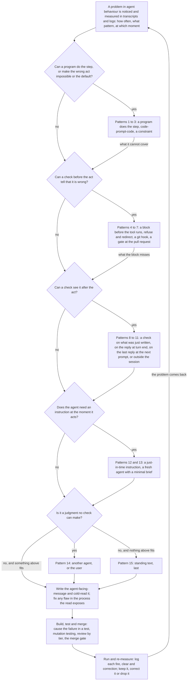

# Key concepts for the agent-control techniques pages: an outline

A working outline, not for merging. One line per concept; the prose pages are written from it once it is right. *Proposed* marks what is not built; *question* marks what needs the user's ruling; the numbers in square brackets count this project's hooks on that Claude Code hook event today.

## 0. Why this system is unlike any built before 2026

- It rests on SDLC best practices, but it is far more rigid than any team of people would accept.
- People lack agents' patience: they will not grep every name, follow every rule, or bring a fresh pair of eyes to every check. Agents do, every time the system asks them to.
- So much of the work can run as state machines, gates and checks that would be too onerous for people, and that suit agents well.
- Cheap computing makes the rigidity affordable: ned-box, a 2026 mini PC, runs on the order of a million times as many instructions per second as the PDP-7 that Unix was first written on in 1969, and has about three million times its memory.
- That is why these techniques are not SDLC best practice, or not yet.

## 1. Purpose, scope and principles

- Purpose: instruct and control agents, in what they do, what they say, and how they work with the user and with other agents.
- Scope: fixing a problem in agent behaviour. The parts of the system that work with it each have their own page, linked and not explained here: tool use, the cold read, code-prompt-code, testing, optimising instructions.
- A mechanism beats a prompt, always; but not everything can be a mechanism.
- Prompt and code are a continuum, not a choice: code-prompt-code, a program that hands one judgment to a model, almost always beats a prompt alone.
- A prompt to a fresh agent, given only what the step needs, works far better than the same prompt to a busy agent deep in a long context.
- Good and working beats three things: doing nothing; expecting too much of agents, such as hoping a line in CLAUDE.md will fix a problem; and trying to be perfect, which no system of this size can be.
- Good and working means efficient, reasonably safe, and reasonably quick to build, run and maintain.
- A good-enough check beats none, unless its false alarms teach agents to ignore it.
- Set the system up for success: names, prefixes and suffixes that say what a file is let agents and programs both act on it rightly.
- Effort up front is amortised: a confusing name, renamed once, pays back over thousands of future pull requests.
- Agents forget: their context fades as it grows, they cannot recall a note, and they may believe they remember what they do not. So whatever must be kept exactly goes in a file, a tag or a log, never in an agent's memory.
- Detection comes first: an instruction, a block or a correction does nothing until something detects its moment.
- Every message to an agent teaches: whether the step worked; if not, why; and what to do now.

## 2. The act: what we shape

- A tool call: an edit, a shell command, a file write, a call to a subagent.
- A reply to the user.
- A message to another agent, and the brief a fresh-agent starts from.
- A task created, or marked done.
- A commit, a push, a pull request.

## 3. Moments: when a technique can act

- Before the work:
  - a session starts [SessionStart: 1];
  - a fresh subagent starts [SubagentStart: 0; can add context to the subagent];
  - the brief a program or an agent writes for a fresh-agent;
  - standing text loads: CLAUDE.md, the seat-brief [InstructionsLoaded can only observe].
- The user's prompt arrives [UserPromptSubmit: 3].
- As the act happens: just before a tool runs [PreToolUse: 10].
- When the agent runs a program: its output, its errors and its `--help` say what to do next.
- After the act, as soon as it is detected (*question*: "ASAP-post-detection" as a glossary term):
  - just after a tool runs [PostToolUse: 9; PostToolUseFailure: 1];
  - turn end: the agent or a subagent stops after its reply is shown, so a check on the reply corrects it and cannot block it [Stop: 6; SubagentStop: 1];
  - a task is created or completed [TaskCreated, TaskCompleted: 0; can refuse with a message];
  - a watched file changes, by any means [FileChanged: 0; cannot block, and cannot tell the agent].
- At commit or push: the git hooks, which run whichever agent-binary commits [pre-commit, pre-merge-commit, prepare-commit-msg, pre-push].
- On the user's screen only: a reply is displayed [MessageDisplay: 0; changes what the user sees, never what the agent knows].
- Outside the session, at a pull request: the merge-lane's reviewers, the test run at the head, the merge gate.
- Outside the session, on a schedule: maintenance-jobs, watchers, the daily full test run.
- What reaches a Codex agent: AGENTS.md, the git hooks, the reviewer instructions, and the limits a restricted fresh-agent starts with; no Claude Code hook does.

## 4. Kinds of technique: what it does

- Do it instead: a program does the step; code-prompt-code hands only the judgment to a model.
- Constrain: make the wrong act impossible, or the right act the default: powers withheld, such as one GitHub identity per role and a main branch that takes nothing unreviewed; restricted fresh-agents; settings and `.gitignore` defaults; test isolation. The cheapest and surest kind.
- Detect: notice the moment, or the wrong act (section 5).
- Block: refuse the act.
  - hard-block: nothing overrides it.
  - soft-block: the agent clears it by writing its reason into the marker, or with a prefix on the command once it has checked; each clear logged for review (*proposed*).
  - user-block: only the user's approval, quoted into the marker, clears it.
- Correct: undo or fix the act.
  - a program rewrites the act before it runs [PreToolUse `updatedInput`; not used here];
  - a program rewrites the result the agent sees [PostToolUse `updatedToolOutput`; not used here];
  - a program reverts the act and tells the agent (*not built*: today the agent runs the guarded-file hook's `--restore` itself);
  - the agent is told to correct it, and how;
  - Claude Code's rewind: still to be found out, GHI [Find whether Claude Code's rewind can correct an agent's wrong act, triggered by a program](https://github.com/nedschorus/nedschorus/issues/1758);
  - *question, pending*: which wrong acts a program may undo by itself.
- Instruct: tell the agent.
  - standing: CLAUDE.md, the seat-brief, the glossary; the weakest, fading over a long session;
  - on demand: a skill, triggered by its description;
  - to a fresh agent: hand the step to a subagent or a fresh-agent whose brief holds only what the step needs;
  - just in time: a hook's added context, a program's output or error, a refusal's text;
  - at correction: the message that follows a detected mistake.
- Judge: what no check can decide.
  - another agent: a pull request reviewer, a cold reader, the advisor;
  - the user: an approval-walk.

## 5. Detection: what can trigger a technique

- A pattern in a command, a file or a reply: a keyword, a regular expression, a parsed shell command, parsed Markdown.
- A file name's prefix or suffix: `-nbd`, `-test.py`, `-prompt.md`, `-instructions.md`, `-design.md`, `-draft`.
- A path: a guarded-file, a memory directory, the log-store.
- A hashtag a program reads: `#next_to_present` in walk minutes; `#root_cause`, `#root_cause_not_fixed`, `#follow_up` in a pull request description; `#pre_approved_change` in a marker; also a review's `**Blocks.**` label, which the fix-round program reads.
- A marker file: `.walk-approved`, `.location-write-approved`, `.backup-write-approved`.
- A changed hash: a guarded-file whose git blob hash changed without an approval.
- A repository rule test: a test that fails the push or the merge when a file breaks a rule about its content, such as a citation in standing instructions or an `except: pass`; for such a rule it is cheaper and more complete than a hook.
- A skill's description matching the task in hand.
- A count from logs: a fourth cold-read-full-run of one change; repeated failures.
- A time: a daily job, such as the daily full test run.
- A model's judgment, as code-prompt-code: a cold reader, a reviewer.
- Quality: precise is best, and good enough is allowed. False positives are tolerable while they are rare or soft-blocked; the failure is so many that agents learn to ignore the true ones. False negatives are caught by a later detection.

## 6. Durable state: what agents must not be trusted to remember

- Files and markers: approvals, walk minutes, session-handoffs.
- Tags: hashtags in files and pull request descriptions, read by programs.
- Logs: the shared-log; the log-store (cold-read-records, walks, transcripts, session-dialogs).
- The task list; GHIs and their GHI-MDs.
- Why: it is exact, it lasts as long as needed, and a program can read it, so it can drive a detection.

## 7. The act's states

- Agent chooses an act → Pre-tool check.
- Pre-tool check → Tool runs (nothing detected; context added; a marker clears the block) | Hard-blocked | Soft-blocked | User-blocked.
- Each blocked state → Agent chooses an act (another way; with a reason; after the user's approval).
- Tool runs → Post-tool check → Done | Program corrects → Done (*not built*) | Agent corrects → Agent chooses an act.
- A reply, already shown → Stop check at turn end → the turn ends | the agent is sent back to correct it, with an instruction.

## 8. The workflow: fixing a problem in agent behaviour

1. Notice: the user, a reviewer, an agent or a watcher sees the problem.
2. Measure: search past transcripts and the log-store for how often it happens, in what pattern, and at which moment it could be caught. Build only when CLAUDE.md's rule on guards is met.
3. Choose: the flowchart in section 9, then a pattern from section 10; a program, a block, a detection after the act, a just-in-time instruction, judgment, and standing text last. Pick the moment and the kind together.
4. Write the agent-facing-message.
5. Cold-read it: a fresh-reader's misreadings often expose a flaw in the process itself; fix the process, not only the words.
6. Build and test: cause the failure in a test; run mutation testing on the code that handles it; for a changed Bash guard, replay recorded commands through it at main and at the head to see which verdicts change. A reminder fires once for each thing it reminds of; a check that could not run says so, and never reads as a pass.
7. Review and merge: merge-lane-2.
8. Run: logs record each fire, clear and correction; a detector's precision is measured on labelled examples.
9. Re-measure: keep it, correct it or drop it; the page's "Tried, then corrected or dropped" list.

## 9. Choosing a technique: the flowchart

## 10. Patterns: the techniques, grouped

Patterns combine, and most fixes use two: a block that names the program to use; a check after the act behind a block that a shell can route around; a line of standing text backed by a hook. Each pattern gives its kind and its moment, when to use it, and one example built here; the inventory lists every technique.

1. **A program does the step, or keeps what agents would have to remember.** Do it instead; when the agent runs it, after the act, or on a schedule. A program does a step agents get wrong or forget, or holds the state they would otherwise have to recall. Use when the step is mechanical, or its rules are too many to keep in mind: this removes the problem instead of reminding agents of it. Example: a program keeps each checkout up to date with main, and tells the agent when a file of standing instructions it may be following has changed.
2. **Code-prompt-code.** Do it instead; when the agent runs it. A program does everything but one judgment, hands that judgment to a fresh model with a minimal brief, and acts on the answer. Use when one step needs judgment and the rest is mechanical: the program keeps the counts, the files and the limits, which agents lose. Example: the cold read, where a program freezes a copy of the document, starts fresh cold-read-cells on it, collects their reports, and refuses a fourth full run of one change.
3. **Constrain.** Constrain; before the work. Withhold the power, or set the default, so that the wrong act cannot happen or the right one happens unasked. Use when the agent never needs to do the wrong act. Example: each role's GitHub identity lacks the powers its role does not need; a fresh-agent that reviews starts without project hooks, Bash or credentials.
4. **A block before the tool runs: hard, soft or user.** Block; just before a tool runs. A hard-block refuses an act that is always wrong; a soft-block refuses until the agent has checked and says why, in a marker or a prefix on the command, and each clear is logged; a user-block refuses until the user's own words, quoted into a marker, approve the act. Use a hard-block only where the check has almost no false alarms, a soft-block where it is usually right, and a user-block where only the user may decide. A check that parses commands misses other routes to the same act, so back it with a check after the act (pattern 8) or at commit or push (pattern 6). Examples: a tmux kill that names no server is refused (hard); keystrokes sent to a terminal are refused until the agent has checked the target and reruns the command with `CLAUDE_VERIFIED_DETACHED=1` (soft); a change to an instruction file waits for `.walk-approved` holding the user's words (user).
5. **Refuse and redirect.** Block, then do it instead; just before a tool runs. Refuse a hand-typed command for a step that a program does right, and name the program; or hand back the corrected command whole. Use when a program or a mechanical fix exists, so the refusal costs the agent one step. Examples: a hand-typed `codex exec` is refused, and the agent sent to `scripts/run-codex-task-from-brief.py`; a search whose file name the shell would pass as an option is refused, with the command corrected.
6. **A git hook.** Block, or do it instead; at commit or push. Git runs it for every agent-binary, Codex included, whatever command made the commit or the push. Use when the act is a commit or a push, however it was typed. Examples: the pre-commit hook refuses a commit made under the wrong identity; the pre-push hook runs the test suites whose inputs changed.
7. **A gate at the pull request.** Block, and judge; at a pull request. A program refuses the merge until something it can read is in place, and reviewers are chosen by what the pull request changes. Use for what must hold before main changes, which the agent that made the change cannot be trusted to check. Example: the merge gate refuses a pull request whose description has no `#root_cause`, `#root_cause_not_fixed` or `#no_defect_fixed` line.
8. **A check on what was just written.** Detect, then correct or instruct; just after a tool runs. Check the file just written, and tell the agent what is wrong and how to fix it. Use when the mistake shows in the file and the fix is the agent's to make. Examples: a Markdown paragraph broken across lines is reported; words the style guide lists are named, with what to write instead.
9. **A check on the reply at turn end.** Detect, then correct; at turn end. The reply has already been shown; a Stop hook finds a pattern in it, sends the agent back once with what to fix, and logs each fire, so that false alarms can be counted. Use when the mistake is in what the agent tells the user, and worth correcting now. Example: a reply that does not name the approval-walk item waiting for the user is sent back to name it.
10. **A note on the last reply when the next prompt arrives.** Detect, then instruct; when the user's prompt arrives. Add a note to the agent's next turn about its last reply, without stopping anything. Use when the mistake is small and the agent should know for next time. Example: a reply naming a ned-box path, which the user cannot open on his Mac, gets a note at the next prompt.
11. **Detection outside the session.** Detect; at commit or push, at a pull request, or on a schedule. A rule test in the repository fails the push or the merge when a file breaks a rule about its content; a scheduled job finds what no session sees. Its report must reach an agent or the user who will act on it, or it detects nothing. Use for rules about files' content, and for state that no session watches. Examples: a test fails when a standing instruction carries a citation; the test run at a pull request's head reports to merge-lane-2 before it merges.
12. **A just-in-time instruction.** Instruct; just before the act, or when the agent runs a program. The instruction arrives when it applies: a hook's added context, a program's output or error saying what to do next, or a skill's steps, loaded when the agent judges that the skill's description matches its task. Use when the agent can do the step but forgets how or when. Example: a push that changes Markdown gets a reminder to run the citation checks first.
13. **A fresh agent with a minimal brief.** Instruct, or judge; when a subagent or fresh-agent starts. Hand the step to a fresh agent whose brief holds only what the step needs. Use when the step needs care that a busy agent, deep in a long context, gives badly. Example: new shared names go to the naming fresh-agent, which checks them against the naming page.
14. **Judgment by another agent or the user.** Judge; at a pull request, before the user decides, or when an agent asks. A reviewer, a cold reader, the sanity-check, the advisor; the user in an approval-walk. Use when no check can decide, and say what is judged, against what. Example: pull request reviewers, chosen by what the pull request changes.
15. **Standing text.** Instruct; before the work. CLAUDE.md, AGENTS.md, the seat-brief, the glossary, and the rule pages they point to. Use for what every agent needs everywhere, said briefly; never as the only fix for a mistake that recurs, because it fades over a long session. Example: CLAUDE.md's rule on when a guard, a validation, a retry or a workaround earns its place.

## 11. Pending

- The technique inventory is done, 110 techniques, in `docs/drafts/agent-control-techniques-inventory-draft.md`; section 10 groups them into patterns.
- Exceptions: what stays off the pages, and why.
- Questions: "ASAP-post-detection" and "just-in-time" as glossary terms; "block-and-inform" (walk item 2); logging soft-block clears; MessageDisplay for fixes meant only for the user; FileChanged for guarded-files changed by shell commands (GHI [Catch a guarded file changed without the user's approval, ask him, and keep every version](https://github.com/nedschorus/nedschorus/issues/1268)); rewriting an act instead of refusing it.
