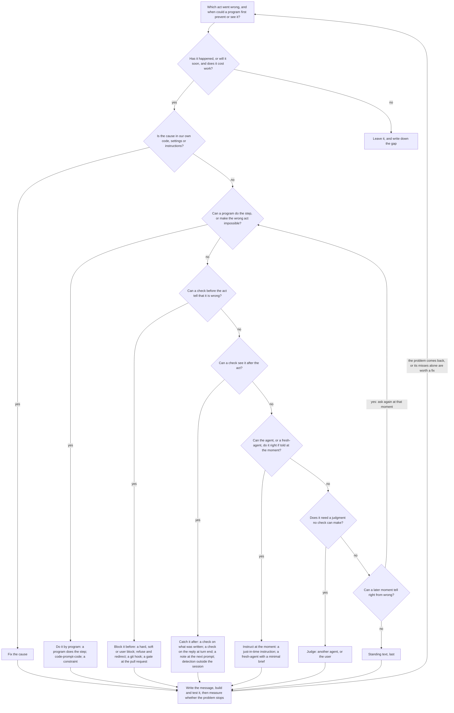

# Techniques that shape what agents do and say, with hooks, prompts and code

A draft. This page says how the project makes its AI agents do and say the right thing, and how to fix a problem in their behaviour. The detail lives in two companion pages: [hooks in each agent-binary: when they run, who sees their output, and what they can change](nedschorus-hooks-in-each-agent-binary-when-they-run-who-sees-their-output-and-what-they-can-change.md), and the [inventory of every technique](agent-control-techniques-inventory-draft.md).

## Overview

**In short.** Agents are patient but forgetful: a rule read at the start of a long session fades, while a program that acts at the right moment does not. So the project controls its agents mainly by mechanism, tells them what they need at the moment they act, and leaves standing text for last. To fix a problem, name the act that went wrong and the first moment a program could prevent or see it, then walk the flowchart below: the first of its questions answered yes picks the technique. Tell the agent what was stopped and what to do, and judge the fix by whether the problem stops recurring.

### The problem

The project is run by AI agents working for one user: Claude Code agent-seats, and Codex and Gemini agents for some tasks, on two machines. What we shape is an agent's act: a tool call, such as an edit, a shell command or a file write; a reply to the user; a message to another agent, or the brief a fresh-agent starts from; a task created or marked done; a commit, a push or a pull request.

Agents fail in ways people do not. Their context fades as it grows, so an instruction read an hour ago no longer steers them. They cannot recall a note they have not reread, and may believe they remember what they do not. They state with confidence what they have not checked.

They also have a patience people lack. An agent will search every name, follow every rule and bring a fresh pair of eyes to every check, when a program asks it to at the moment. No team of people would accept the rigidity that takes; agents do, and cheap computing pays for it: ned-box, a 2026 mini PC, runs about a million times as many instructions per second as the PDP-7 that Unix was first written on. So much of the work runs as state machines, gates and checks that would be too onerous for people. That is why these techniques rest on SDLC best practice but are not yet part of it.

### What the flowchart stands on

**A mechanism beats a prompt.** Where a program can decide a step, it decides. Where only a judgment can, a program detects the moment, gathers what the judgment needs and hands it on; it never guesses in the judgment's place.

**Prompt and code are a continuum.** Code-prompt-code, a program that hands one judgment to a model and acts on the answer, almost always beats a prompt alone. A fresh-agent given only what the step needs beats a busy agent deep in a long context. The judgment goes to whoever already holds what it needs: a fresh model when a program can gather the facts, and the acting agent, told what the program found, when the facts are only in its own context.

**Detection comes first.** An instruction, a block or a correction does nothing until something detects its moment. The moments, in the order of the work, are: before the work starts; when a fresh-agent or subagent starts; when the user's prompt arrives; just before a tool runs; when the agent runs a program; just after a tool runs; at turn end, after the reply is shown; at commit or push; at a pull request; and on a schedule. A technique acts at the first moment that can prevent or see the wrong act, and at a later one only where the first cannot tell right from wrong.

**The ladder.** The kinds of technique, from surest to weakest, are: do the step by program, or make the wrong act impossible; block it before it happens; catch it after and correct it; instruct the agent at the moment; hand it to a judge; and last, standing text such as CLAUDE.md, which fades over a long session. The flowchart walks down this ladder.

**State lives outside the agent.** Whatever must be kept exactly goes in a file, a tag or a log a program can read: an approval, the walk-minutes, a session-handoff, the task list, the log-store. A record is written where its readers already read, at the moment it is made.

**Every message teaches.** A block, a correction or a note says what was stopped or found, why it is wrong, and what to do now. A false alarm costs more than its turn, because enough of them teach agents to ignore the true ones. So a block fires only where its check is nearly always right, a detector that can run the program it would send the agent to runs it first and fires on the result, and a reminder fires once for each act it finds.

**Good and working beats perfect.** Build only for a failure that has happened, or soon will, and that costs work. Fix a cause in the project's own code first, and use what already exists. Add one technique at one moment, measure it, and add a second only for a gap the measure shows. The measure is whether the problem stops recurring, never how often the technique fires.

**Set the system up for success.** A name, prefix or suffix that says what a file is lets agents and programs act on it rightly, and a confusing name renamed once pays back over thousands of pull requests.

**A technique reaches only what runs it.** A Claude Code hook reaches Claude Code agents only, and a git hook reaches every agent-binary that commits. A hook that fails with an error tells only the user, not the agent, and a guard that crashes or times out lets the act through unless it is set to block when it fails. Check each channel a design depends on, in the companion page on hooks, before building on it.

## The flowchart

## The flowchart explained

### As a whole

Start from one act and the first moment a program could prevent or see it. Two gates come before any technique: whether the problem is worth a fix, and whether its cause is the project's own. Then five questions walk down the ladder, and the first one answered yes picks the technique. Ask the five questions of the first moment; only where that moment cannot tell right from wrong, ask them again of a later one, which is the chart's last question. A technique can miss some episodes; walk the chart again for those misses only, and only when they alone are worth a fix. Most fixes are one technique at one moment; three or more mean the problem was not cut small enough. Every fix ends the same way, with a message, a test and a measure, and the chart starts again if the problem comes back.

Where common problems usually land:

| The problem | The first moment a program can see it | Where it usually lands |
|---|---|---|
| A wrong edit, command or file write | just before the tool runs | a constraint, if the act is never needed; otherwise a block, or refuse and redirect |
| A wrong commit or push | at commit or push | a git hook |
| A mechanical step done wrong or forgotten | just after the act it follows, or on a schedule | a program does the step |
| A wrong or unclear reply to the user | at turn end, or when the next prompt arrives | a check on the reply, or a note at the next prompt |
| A step that needs care a busy agent will not give | when the agent runs a program, or when a fresh-agent starts | code-prompt-code, or a fresh-agent with a minimal brief |
| A rule about what files contain | at push, or at the pull request | a repository rule test, which fails the push or the merge when a file breaks the rule |
| State that no session watches | on a schedule | a scheduled job whose report reaches someone who acts |
| A decision only the user may make | before the act | a user-block, or an approval-walk |

### Piece by piece

**Which act, and when.** Measure before choosing, from transcripts and the log-store: the episodes before and since any earlier fix, what each cost, the route each took (the tool, the agent-binary and the machine), the act that went wrong, and the first moment a program could have seen it. The counts decide whether to build and which moment to use; measure again only to pick a moment or tune a detector, never to put off the choice.

**Is it worth a fix?** Build when the failure has happened, or is foreseeable within a month on concrete evidence, and it loses or damages work, stops work beyond the task that failed, or goes unnoticed until it does. Otherwise write down the gap and leave it. A month's harm sizes the fix: what it costs to build and run should come back within a few months.

**Is the cause our own?** Look first for a cause in the project's own code, settings or instructions, and fix that rather than guard against it. A line of standing text added since the episodes does not count as a fix, so do not wait to see whether it worked.

**Can a program do the step, or make the wrong act impossible?** Ask it of each step of the problem, not of the whole: a problem that needs judgment at one step is often mechanical at the others. This removes the problem instead of reminding agents of it.

| Technique | When to use it | Built here |
|---|---|---|
| A program does the step, or keeps what agents would have to remember | the step is mechanical, or its rules are too many to keep in mind | a program keeps each checkout up to date with main, and tells the agent when standing instructions it may be following have changed |
| Code-prompt-code | one step needs judgment, and a program can gather what that judgment needs; the program keeps the counts, the files and the limits that agents lose | the cold read: a program freezes the document, starts fresh readers on it, collects their reports, and refuses a fourth full run of one change |
| A constraint | the agent never needs to do the wrong act; the cheapest and surest technique | each role's GitHub identity lacks the powers its role does not need; a reviewing fresh-agent starts without project hooks, Bash or credentials |

**Can a check before the act tell that it is wrong?** A check that reads a command misses other routes to the same act, so back it with a check at commit or after the act.

| Technique | When to use it | Built here |
|---|---|---|
| A hard-block | the check has almost no false alarms; nothing overrides it | a tmux kill that names no server is refused |
| A soft-block | the check is usually right; the agent clears it once it has checked, with a prefix or a reason | keystrokes sent to a terminal are refused until the agent has checked the target and reruns the command with `CLAUDE_VERIFIED_DETACHED=1` |
| A user-block | only the user may decide; his quoted words clear it | a change to an instruction file waits for `.walk-approved` holding the user's words |
| Refuse and redirect | a program does the step right, so the refusal costs the agent one step | a hand-typed `codex exec` is refused, and the agent sent to `scripts/run-codex-task-from-brief.py` |
| A git hook | the act is a commit or a push, however it was typed; git runs it for every agent-binary | the pre-push hook runs the test suites whose inputs changed |
| A gate at the pull request | what must hold before main changes, which the agent that made the change cannot be trusted to check | the merge gate refuses a pull request whose description has no root-cause line |

**Can a check see it after the act?**

| Technique | When to use it | Built here |
|---|---|---|
| A check on what was just written | the mistake shows in the file, and fixing it is the agent's job | a Markdown paragraph broken across lines is reported |
| A check on the reply at turn end | the mistake is in what the agent told the user, is worth a turn to correct now, and is seldom detected; the reply has already been shown | a reply that does not name the approval-walk item waiting for the user makes the agent take another turn, whose message names it |
| A note at the next prompt | the mistake is small, or detected too often to send the agent back each time; a note costs no turn | a reply naming a ned-box path, which the user cannot open on his Mac, gets a note |
| Detection outside the session | a rule about what files contain, or state that no session watches; its report must reach an agent or the user who will act on it | a test fails when standing instructions carry a citation; the tests at a pull request's head report to merge-lane-2 |

**Can the agent, or a fresh-agent, do it right if told at the moment?**

| Technique | When to use it | Built here |
|---|---|---|
| A just-in-time instruction | the agent can do the step but forgets how or when; it arrives as a hook's added context, a program's output or error, or a skill's steps | a push that changes Markdown gets a reminder to run the citation checks first |
| A fresh-agent with a minimal brief | the step needs care that a busy agent gives badly, and the brief can carry all the step needs | new shared names go to a fresh-agent that checks them against the [naming page](../nedschorus-wiki/nedschorus-how-to-choose-a-name-for-files-code-and-glossary-terms.md) |

**Does it need a judgment no check can make?** Hand it to another agent, such as a pull request reviewer, a cold reader, or the advisor, a stronger model an agent can consult, or to the user, in an approval-walk. Say what is judged, and against what.

**Standing text, last.** CLAUDE.md, AGENTS.md, the seat-brief and the rule pages they point to hold what every agent needs everywhere, said briefly. Standing text is never the only fix for a mistake that recurs, because it fades over a long session, and it reaches only the agents whose binary loads its file.

**The message.** Write the agent-facing-message in three parts, in order: what was stopped or found, quoting the words or the command; why it is wrong, in words the agent can pass on to the user; and what to do now, one instruction per line with the condition it applies under, naming the program that does the step where one exists. Block the act, or send the agent back, only for a detector that is right nearly every time and fires seldom; otherwise, add a note at the next turn.

**Build and test.** Cause the failure in a test, and run mutation testing on the code that handles it. A check that could not run says so, never reads as a pass, and holds the act only when the act cannot be undone. Have the message cold-read: a fresh reader's misreading often exposes a flaw in the process itself, which is what to fix. Then merge-lane-2 reviews and merges it.

**Measure whether the problem stops.** Log each fire, each clear and each correction, and measure a detector's precision on labelled examples. Count the episodes again from the same sources as before the fix, then keep the technique, correct it or drop it. A technique that keeps firing while the episodes go on has not worked.
