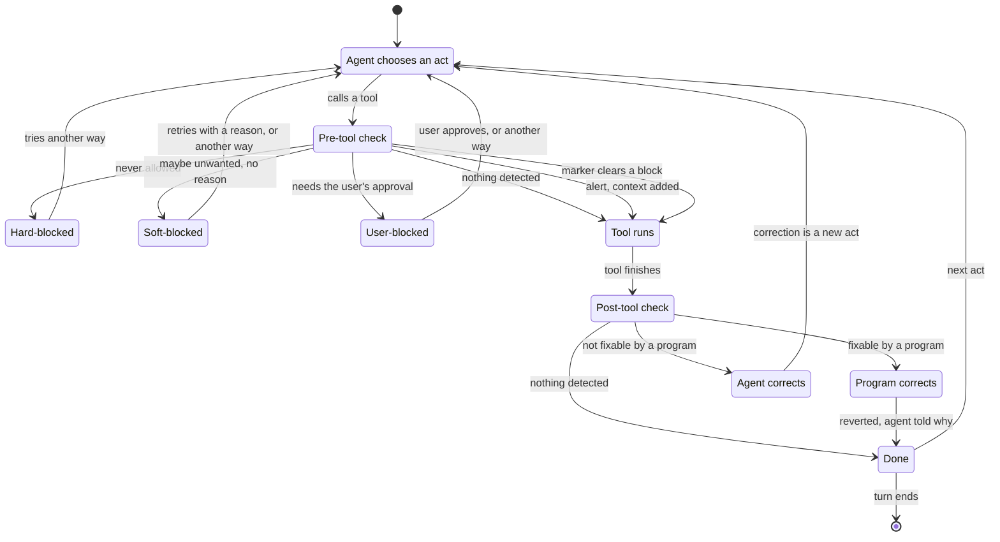

# Techniques that shape what agents do and say, with hooks, prompts and code

This project's purpose is instructing and controlling agents: in their work, in what they say, and in how they work with the user and each other. This page lists its techniques. Read it before you propose a rule for CLAUDE.md or another file of agent-instructions, and before you build a hook or a check. To save a lesson, read [the page on saving a lesson where an agent meets it](nedschorus-how-to-save-a-lesson-where-an-agent-meets-it-when-it-applies-instead-of-in-a-memory-note.md).

The goal is good enough, not perfect: efficient, reasonably safe, and reasonably quick to build, run and maintain. A detection that is good enough, as a skill's trigger is, is very useful. A block that refuses some correct acts and misses some wrong ones is acceptable: a soft-block lets the agent past a wrong refusal, and a detection after the act catches what the block missed.

*Planned* marks what is decided but not built; *proposed* marks what is suggested but not decided; *pending a user-ruling* marks a question put to the user. Hooks are Claude Code's, so a technique built as a hook does not reach a Codex agent.

## Choosing a technique

Ask these questions in order, and use each technique that fits: they work together, so a program may also carry a block, a check after the act and a reminder.

1. **Can a program do the work?** Then a program does it, handing only the judgment to a prompt: code-prompt-code. A rare step that one sentence states needs no program.
2. **Can a check before the act tell that the act is wrong?** Then refuse the act, and say in the refusal what to do instead: block-and-inform. When the check will often refuse a correct act, make the refusal a soft-block. For the wrong acts the check misses, go on to question 3.
3. **Can a check see the wrong act only after it happens?** Then detect it, tell the agent, and have it corrected: detect-inform-correct.
4. **Does the agent need to know or be reminded of something to act as instructed?** Then tell it just before it acts: a note, a reminder of a tool, a skill or a code-prompt-code procedure, or steps to follow. An instruction lies dormant unless a detection triggers it; a skill's `description:` line is often trigger enough.
5. **Is it judgment no check can make?** If another agent can judge it, a review by another agent; if only the user can decide it, an approval-walk.
6. **Only if none fits:** a line in the seat-brief when only one agent-seat does that work, in the glossary when it is what a word means, and last, in CLAUDE.md or the user's own `~/.claude/CLAUDE.md`. Text loaded at the start of an agent-session works well for a fresh, short-lived agent, and poorly for a long-lived one after 50,000 tokens of context.

A hook is best mechanical and precise, but a detection or a correction that is only good enough is allowed. Something is better than nothing, unless false positives are so many that agents learn to ignore the true ones.

## How an agent's act passes through these techniques

| State | What happens |
|---|---|
| Agent chooses an act | The agent decides on a tool call. A correction it makes is a new act, and starts here. |
| Pre-tool check | A PreToolUse hook reads the call. An alert adds a note to the agent's context and lets the tool run; *proposed:* an alert that also turns on a check for after the tool. A marker that clears a block, a soft-block's reason or a user-block's approval, lets the tool run; *proposed:* log and review each such clear, since a soft-block may scare agents off a correct act. |
| Hard-blocked | Nothing overrides the refusal. It says what happened, why, and how to go on; expect the agent to find another way. |
| Soft-blocked | The refusal says why, and that an agent with a reason to go ahead writes it into the marker the refusal names and tries again. |
| User-blocked | Only the user's approval, quoted into the marker the refusal names, clears it. |
| Post-tool check | A PostToolUse hook looks for what went wrong: a file whose hash changed, a file created, deleted or renamed with a known prefix or suffix, a hashtag added. |
| Program corrects | A program reverts or fixes the result, and tells the agent the right technique; the lesson fades as its context grows. |
| Agent corrects | The agent is told to undo the act as best it can, and taught the right technique. |

A reply to the user is an act too, checked by the reply hooks under Correction.

## When a program does the work

- **Code-prompt-code (CPC).** A long procedure in prose is followed unreliably, so a program does the steps and hands a prompt only the judgment. Built: `nc-systems/cold-read/cold-read-grid.py`; `scripts/ghi-info-ask.py`. *Planned:* a walk-runner for approval-walks.
- **Code does the step.** For a step agents forget even when reminded: `scripts/git-client-side-hooks/prepare-commit-msg` stamps the session trailer on each commit.
- **Reuse what is built.** *Planned:* a page of reusable components, and a hook that names the right row when an agent writes a solved problem again: GHI [Agents reuse what the project has already solved: shared helpers, one page of reusable components, and a reuse check before, during and after the build](https://github.com/nedschorus/nedschorus/issues/1123).

## Detection

A detection notices the moment a technique applies, before the act or after it. Without one, nothing else fires.

- **A pattern in the act.** A hook matches a keyword or a command form in the tool call, the text just written, or the reply. Before the act: `scripts/hand-typed-codex-exec-redirect-hook.py` matches a hand-typed `codex exec`. After it: `scripts/style-guide-word-checker-markdown-edit-hook.py` reports words the style guide lists.
- **A file name's prefix or suffix.** The kind of file is in its name. `.claude/hooks/instruction-file-guard.py` knows a reusable prompt by `-prompt.md` or `-instructions.md` and a reviewed design by `-design.md`; `scripts/run-all-test-suites.py` runs every `*-test.py` and `*-test.sh`; a pull request reviewer holds a file ending `-nbd` to the nice-but-dirty limits only.
- **A hashtag that code reads.** A program finds a fixed hashtag exactly, where it misreads a label in prose: the walk-minutes' `#next_to_present` line; the merge gate's `#root_cause`, `#root_cause_not_fixed` and `#no_defect_fixed` lines.
- **A skill's description.** A skill's `description:` line says when to use it, so the agent itself detects the moment; good enough, not exact. Built: every skill in `.claude/skills/`.
- **A task's due time or prerequisite.** A promise to act later becomes a task whose metadata a program checks at each turn's end: `scripts/agent-seat-due-task-raise-hook.py`.
- **The project's parsers.** A hand-written regular expression misreads ordinary input. Use the shared parsers in `nc-systems/general-tools/`: `shell-command-tree-sitter-bash-reader-common.py` for shell commands, `git-machine-readable-output-runner-and-parser-common.py` for git output, `python-source-agent-facing-string-collector-common.py` for messages in Python. For Markdown, use the markdown-it-py library; *planned:* a shared module on it.

## Blocking

- **Block-and-inform.** A PreToolUse hook refuses the tool call, and its refusal, an agent-facing-message, says what to do instead. A refusal is a hard-block, a soft-block or a user-block, by what clears it, as the state machine above shows. Built: `scripts/hand-typed-codex-exec-redirect-hook.py` refuses a hand-typed `codex exec` and names `scripts/run-codex-task-from-brief.py`; `.claude/hooks/instruction-file-guard.py` refuses an edit of a guarded-file until a `.walk-approved` marker holds the user's approval, a `#pre_approved_change` line with its reason, or an obvious-fix marker, so one refusal can accept more than one kind of clear. Write the refusal by [the agent-facing-message page](nedschorus-how-to-write-an-agent-facing-message-such-as-a-hook-refusal-or-script-error.md).
- **A gate in code.** A program refuses to go on without a step agents skip: `scripts/merge-gate.sh` refuses a pull request whose description lacks a root-cause line.
- **The approval-walk Stop hook.** While an approval-walk is open, it refuses to end a turn whose reply does not name the item waiting for the user. Built: `nc-systems/skills/walk-me-through/walk-me-through-current-item-shown-to-user-after-each-agent-message-stop-hook.py`.

## Correction

- **Detect-inform-correct (DIC).** A check before the act misses some routes, such as a shell command that changes a guarded-file. A program detects the act just after it, while a fix is cheap, and a program or the agent corrects it. Built: `.claude/hooks/guarded-file-unapproved-change-afterward-backup-and-ask-hook.py` backs up a guarded-file changed without approval and has the agent ask the user; `scripts/markdown-edit-hard-wrapped-paragraph-reminder-hook.py` tells the agent to rejoin a paragraph it broke across lines. *Pending a user-ruling:* which wrong acts a program may undo itself, and which the agent must correct.
- **Detect-inform-correct on a reply.** A hook reads the agent's reply and tells it what broke a rule. A Stop hook has it fix the reply in the same turn: `scripts/cold-read-fast-read-due-for-linked-document-reminder-hook.py`, `scripts/absence-claim-locator-reminder-hook.py`. A UserPromptSubmit hook has it correct itself in the next reply, since the user has read the first: `scripts/bare-number-citation-in-markdown-and-agent-reply-warning-hook.py`, `scripts/ned-box-path-in-agent-reply-unclickable-on-mac-warning-hook.py`.
- **Rewind.** Claude Code's rewind may serve as a correction; whether and how a program can use it is to be found out: GHI [Find whether Claude Code's rewind can correct an agent's wrong act, triggered by a program](https://github.com/nedschorus/nedschorus/issues/1758).

## Instruction

Whatever the technique, tell the agent whether its step worked, and if not, why not and the best way to do it, as [the agent-facing-message page](nedschorus-how-to-write-an-agent-facing-message-such-as-a-hook-refusal-or-script-error.md) says. The places below run from strongest, at the moment the instruction applies, to weakest, at the start of an agent-session.

- **A reminder on the act.** A hook adds a short note to the agent's context and lets the act go ahead. Before the act: `nc-systems/general-tools/claude-code-bash-git-push-of-markdown-change-citation-checks-reminder-hook.py` names the citation checks on a push that changes Markdown. After it: `scripts/new-shared-names-reminder-hook.py`; `nc-systems/general-tools/python-edit-changed-agent-facing-message-check-reminder-hook.py`.
- **The steps of a skill.** For a procedure that needs judgment at each step; read when the skill's description triggers it.
- **A program's output and manual.** A rule about one tool belongs in the tool's result or its `--help` text, where the agent reads it. Built: `scripts/ghi-info-ask.py` says how to include closed GHIs after searching only open ones.
- **The seat-brief.** One agent-seat's instructions go in its seat-brief, which reloads after compaction; those for its start only go in initial-agent-instructions such as `docs/agents/seat-first-prompt.md`.
- **The glossary.** A technique agents find odd gets a project-term in `docs/nedschorus-wiki/nedschorus-glossary.md`.
- **CLAUDE.md, last.** Like a [nice-but-dirty](nedschorus-glossary.md) component, CLAUDE.md mostly works but not always: it is simple and helpful, but unreliable, and short on room. It is read at the start of an agent-session, and agents ignore it by the time a rule applies. Extend the sentence that already covers the action before adding a bullet.
- **A cold read of every instruction.** The agent that reads an instruction has a different context from the one that wrote it, so fresh-agents read the text before it is used: the `/cold-read` skill.

## Where only judgment will do

- **A review by another agent.** An agent without the worker's context reviews the work: a fresh-agent; the other agent-binary, such as the Codex reviewer of each pull request (`scripts/code-review-codex-cell.py`); Claude Code's `advisor` tool, which some agent-sessions have: a stronger model that reads the agent's whole conversation and advises it; or `/sanity-check` for a design.
- **An approval-walk.** `/walk-me-through` puts decisions to the user one item at a time.

## Tried, then corrected or dropped

- **Corrected: a soft-block on listed words and phrases.** It scared agents away from the tool it guarded; a note added to their context replaced it.
- **Corrected: hard-blocks in place of soft-blocks everywhere.** It cost days of work and millions of tokens.
- **Corrected: parsing shell commands as a complete guard.** A shell has too many routes to a file; detect-inform-correct catches what the parse misses.
- **Dropped: a watcher that read agents' transcripts and sent alerts.** The alerts were not useful.
- **Replaced by this page: a ladder of techniques, and a table of hook events by moment.** Both sorted mechanisms by when they act; this page sorts them by their job.

## Not built yet

- *Proposed:* a hook that starts slow checks early so that a later hook adds their result: GHI [One Claude Code hook starts slow work early and a later hook adds the result, and a wiki page on hook techniques for controlling and instructing agents](https://github.com/nedschorus/nedschorus/issues/1515).
- *Planned:* an hourly maintenance-job that raises due tasks to an idle agent-seat: GHI [Tasks raise themselves when their due time passes or their prerequisite is met](https://github.com/nedschorus/nedschorus/issues/940).
- *Planned:* a Stop hook that refuses a reply promising later work until a task backs the promise: GHI [A project style guide: words to avoid, a mechanical checker, and a check on unbacked promises](https://github.com/nedschorus/nedschorus/issues/14).
- *Proposed:* a hook that reminds an agent to run macOS `say` when it needs the user's attention; today that is a line in the user's `~/.claude/CLAUDE.md`.
- *Pending a user-ruling:* a store that recalls lessons by subject: GHI [Save each lesson where agents meet it at the moment it applies, and decide whether a store that recalls lessons by subject is worth building](https://github.com/nedschorus/nedschorus/issues/1349).

**Checked against:** commit [ce539455629470f01b6d247b20c47bb058c3a221](https://github.com/nedschorus/nedschorus/commit/ce539455629470f01b6d247b20c47bb058c3a221)
